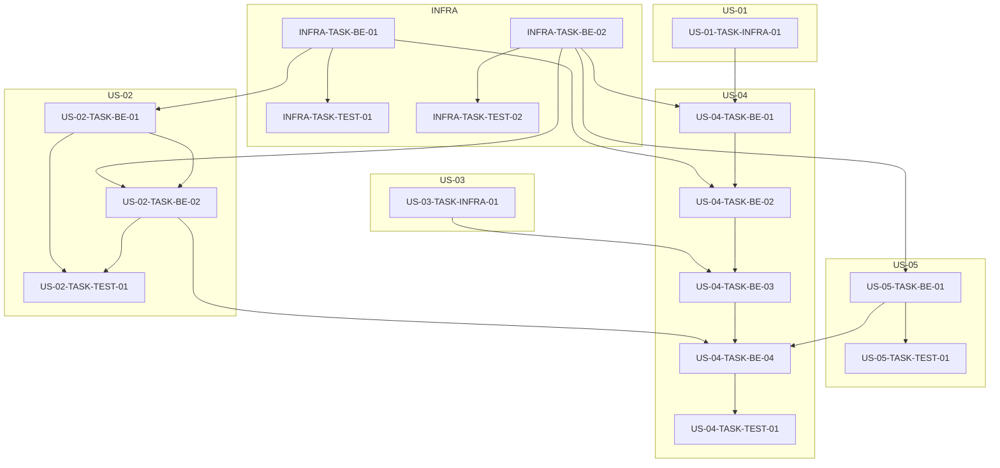

# FTR-020 — Dependency Graph & Implementation Sequence

> Human-readable companion to [`plan.json`](plan.json) — the machine-readable file is
> authoritative; this is a rendered view of the same data, regenerated alongside it, never
> hand-edited independently (same convention as `{PREFIX}-Work-Breakdown.md` being generated
> from the JSON it describes — see `wb-render.js`).

## Dependency graph

## Sequence and waves

The dispatch order (`readyQueue`), the per-task dependencies (`dependsOn`), and the phase
waves (`phaseWaves`) are **not repeated here** — they already exist as structured data in
[`plan.json`](plan.json) and reprinting them as a Markdown table would just be the same facts
in a second place, free to drift the moment `plan.json` is regenerated and this file isn't.
Read them straight from there; the Mermaid diagram above is the only rendering kept in this
file, because it's a genuinely different representation (visual graph) rather than the same
rows reformatted.

## Integrity

- **Source digest:** `sha256:83faa4e68c8d4a1f5ed4d1bdef2605ee5934541e779ccdb42f2a7d988a2cbb7e` —
  computed over every file under `wbs/` (sorted by relative path, each length-prefixed before
  hashing, same technique as `lib/task-executor/plan.js`'s own `_computePlanDigest`, extended
  from "two byte blobs" to "every file in a directory"). A re-run of the same computation
  against the current `wbs/` must reproduce this exact value, or this plan is stale and must be
  regenerated before implementation proceeds — mirrors `plan.js`'s existing resume-safety
  contract, made an explicit, reviewable file instead of an internal runtime-only check.
- Per-task and per-phase checksums in `plan.json` let a drift check point at the *specific*
  file that changed, not just "something changed somewhere."
